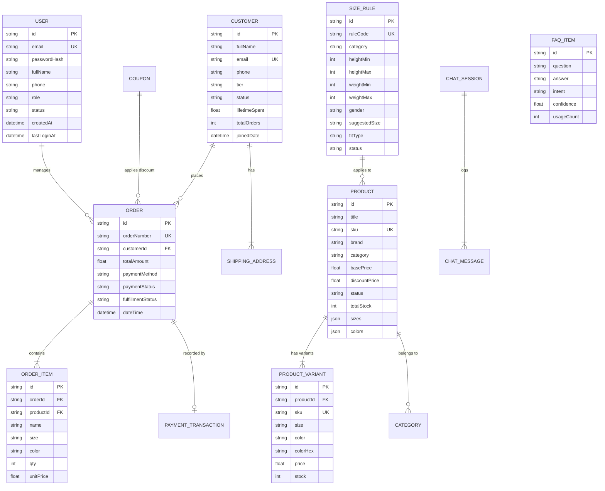

# THIẾT KẾ CƠ SỞ DỮ LIỆU (DATABASE SCHEMA) - SPORTX E-COMMERCE

> **Dự án**: Website Bán Đồ Thể Thao Tích Hợp Chatbot & Thanh Toán Trực Tuyến  
> **Tác giả**: Đinh Công Hùng (MSSV: 2200932)  
> **Cấu trúc lưu trữ**: JSON/Document ACID Store & RDBMS compatible models

---

## 1. Sơ đồ Thực thể - Mối quan hệ (ERD)

---

## 2. Chi tiết các bảng dữ liệu (Data Dictionary)

### 2.1 Bảng `users` (Tài khoản & Phân quyền)
| Tên cột | Kiểu dữ liệu | Ràng buộc | Mô tả |
|---|---|---|---|
| `id` | `VARCHAR(36)` | `PRIMARY KEY` | Mã định danh duy nhất (UUID) |
| `email` | `VARCHAR(150)` | `UNIQUE, NOT NULL`| Email đăng nhập hệ thống |
| `passwordHash` | `VARCHAR(255)` | `NOT NULL` | Mật khẩu băm an toàn qua thuật toán bcrypt (Salt 10) |
| `fullName` | `VARCHAR(150)` | `NOT NULL` | Họ và tên người dùng / nhân sự |
| `phone` | `VARCHAR(20)` | `NULL` | Số điện thoại liên lạc |
| `role` | `ENUM` | `ADMIN`, `STAFF`, `CUSTOMER` | Vai trò và cấp độ phân quyền |
| `avatar` | `VARCHAR(255)` | `NULL` | Đường dẫn ảnh đại diện |
| `status` | `ENUM` | `Active`, `Blocked` | Trạng thái kích hoạt tài khoản |
| `createdAt` | `DATETIME` | `NOT NULL` | Thời điểm tạo tài khoản |
| `lastLoginAt` | `DATETIME` | `NULL` | Lần đăng nhập gần nhất |

---

### 2.2 Bảng `products` (Sản phẩm)
| Tên cột | Kiểu dữ liệu | Ràng buộc | Mô tả |
|---|---|---|---|
| `id` | `VARCHAR(36)` | `PRIMARY KEY` | Mã định danh duy nhất (UUID) |
| `title` | `VARCHAR(255)` | `NOT NULL` | Tên sản phẩm thể thao |
| `sku` | `VARCHAR(50)` | `UNIQUE, NOT NULL`| Mã phân loại kho gốc |
| `brand` | `VARCHAR(100)` | `NOT NULL` | Thương hiệu (Nike, Adidas, Puma, Yonex,...) |
| `category` | `VARCHAR(50)` | `NOT NULL` | Danh mục môn thể thao (`Football`, `Running`, `Gym`, `Badminton`) |
| `basePrice` | `DECIMAL(10,2)` | `NOT NULL` | Giá niêm yết gốc |
| `discountPrice`| `DECIMAL(10,2)`| `NULL` | Giá khuyến mãi (nếu có) |
| `thumbnail` | `VARCHAR(255)` | `NOT NULL` | Ảnh đại diện sản phẩm |
| `status` | `ENUM` | `Active`, `Draft` | Trạng thái hiển thị bán |
| `sizes` | `JSON Array` | `NOT NULL` | Danh sách các kích cỡ (`["S", "M", "L", "XL"]`) |
| `colors` | `JSON Array` | `NOT NULL` | Danh sách màu sắc (`[{"name":"Red","hex":"#DC2626"}]`) |
| `variants` | `JSON Array` | `NOT NULL` | Danh sách các SKU con chi tiết |

---

### 2.2 Bảng `orders` (Đơn hàng)
| Tên cột | Kiểu dữ liệu | Ràng buộc | Mô tả |
|---|---|---|---|
| `id` | `VARCHAR(36)` | `PRIMARY KEY` | ID đơn hàng |
| `orderNumber` | `VARCHAR(30)` | `UNIQUE, NOT NULL`| Mã đơn hàng hiển thị (`SPX-9821`) |
| `dateTime` | `VARCHAR(50)` | `NOT NULL` | Ngày giờ tạo đơn |
| `customer` | `JSON Object` | `NOT NULL` | Thông tin người nhận (Tên, SĐT, Email, Địa chỉ) |
| `items` | `JSON Array` | `NOT NULL` | Danh sách mặt hàng mua kèm Size, Màu, Số lượng |
| `totalAmount` | `DECIMAL(10,2)` | `NOT NULL` | Tổng tiền thanh toán của đơn hàng |
| `paymentMethod`| `ENUM` | `VNPAY`, `MoMo`, `COD` | Phương thức thanh toán đã chọn |
| `paymentStatus`| `ENUM` | `Paid`, `Unpaid` | Trạng thái tiền đã về tài khoản |
| `fulfillmentStatus`| `ENUM` | `Pending Approval`, `Processing`, `Shipping`, `Completed`, `Canceled` | Trạng thái giao hàng |
| `transactionDetails`| `JSON Object`| `NULL` | Chi tiết mã giao dịch cổng thanh toán (`VNPAY/MoMo`) |

---

### 2.3 Bảng `customers` (Khách hàng)
| Tên cột | Kiểu dữ liệu | Ràng buộc | Mô tả |
|---|---|---|---|
| `id` | `VARCHAR(36)` | `PRIMARY KEY` | ID khách hàng |
| `fullName` | `VARCHAR(150)` | `NOT NULL` | Họ tên khách hàng |
| `email` | `VARCHAR(150)` | `UNIQUE, NOT NULL`| Địa chỉ thư điện tử |
| `phone` | `VARCHAR(20)` | `NOT NULL` | Số điện thoại liên hệ |
| `tier` | `ENUM` | `VIP`, `Loyal`, `New` | Phân hạng chi tiêu khách hàng |
| `status` | `ENUM` | `Active`, `Blocked` | Trạng thái tài khoản |
| `lifetimeSpent`| `DECIMAL(12,2)`| `DEFAULT 0.0` | Tổng tiền đã mua sắm trọn đời (LTV) |
| `totalOrders` | `INT` | `DEFAULT 0` | Tổng số đơn hàng đã đặt |
| `addresses` | `JSON Array` | `NOT NULL` | Sổ địa chỉ nhận hàng của khách |

---

### 2.4 Bảng `size_rules` (Quy tắc gợi ý kích cỡ AI)
| Tên cột | Kiểu dữ liệu | Ràng buộc | Mô tả |
|---|---|---|---|
| `id` | `VARCHAR(36)` | `PRIMARY KEY` | ID quy tắc |
| `ruleCode` | `VARCHAR(50)` | `UNIQUE` | Mã rule (`R-APP-001`, `R-SHOE-002`) |
| `category` | `VARCHAR(50)` | `NOT NULL` | Nhóm đồ (`Apparel`, `Shoes`, `Gear`) |
| `heightMin` | `INT` | `NOT NULL` | Chiều cao tối thiểu (cm) |
| `heightMax` | `INT` | `NOT NULL` | Chiều cao tối đa (cm) |
| `weightMin` | `INT` | `NOT NULL` | Cân nặng tối thiểu (kg) |
| `weightMax` | `INT` | `NOT NULL` | Cân nặng tối đa (kg) |
| `gender` | `ENUM` | `Male`, `Female`, `Unisex` | Giới tính áp dụng |
| `suggestedSize`| `VARCHAR(20)` | `NOT NULL` | Size gợi ý (`Size M`, `EU 41.5`) |
| `fitType` | `ENUM` | `Slim Fit`, `Regular Fit`, `Loose Fit` | Form dáng mặc |
| `status` | `ENUM` | `Active`, `Inactive` | Trạng thái kích hoạt rule |
