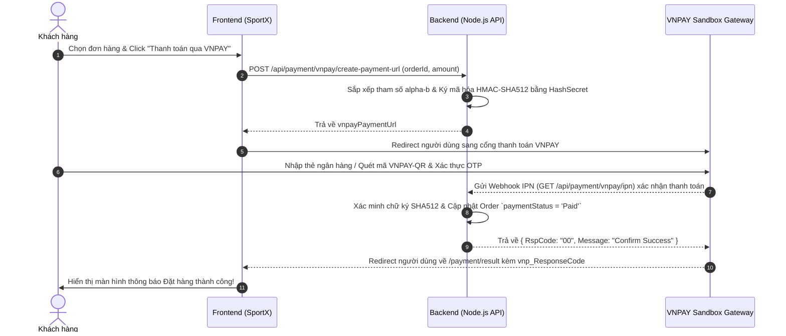
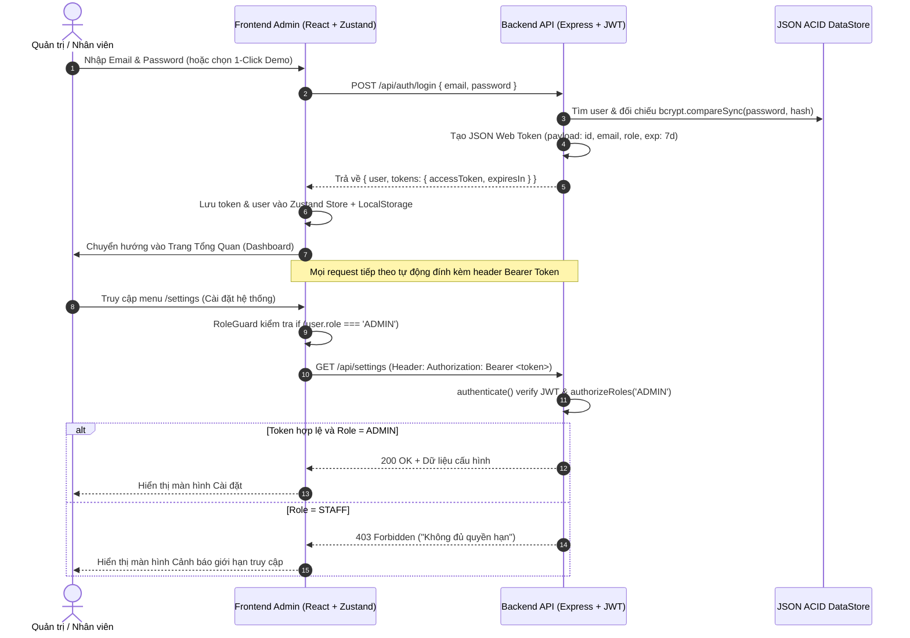

# KIẾN TRÚC HỆ THỐNG (SYSTEM ARCHITECTURE) - SPORTX PLATFORM

> **Đồ án Tốt nghiệp**: Xây Dựng Hệ Thống Thương Mại Điện Tử Thể Thao Tích Hợp Chatbot Tư Vấn & Cổng Thanh Toán Trực Tuyến  
> **Sinh viên thực hiện**: Đinh Công Hùng (MSSV: 2200932)  
> **Kiến trúc**: Clean Layered Architecture (3-Tier) & Micro-service ready

---

## 1. Sơ đồ Tổng quan Kiến trúc Hệ thống

```
  ┌────────────────────────────────────────────────────────┐
  │                 CLIENT LAYER (Frontend)                │
  │  React 19 + TypeScript + Vite + Tailwind CSS + HeroUI  │
  │  - Global State: Zustand (Toast, Modals, UI state)     │
  │  - Server Cache & Async Data: @tanstack/react-query   │
  │  - HTTP Client: Axios Instance (Interceptors & Error)  │
  └───────────────────────────┬────────────────────────────┘
                              │ REST API (JSON)
                              ▼
  ┌────────────────────────────────────────────────────────┐
  │                 APPLICATION LAYER (Backend)            │
  │             Node.js + Express + TypeScript             │
  │                                                        │
  │  ┌───────────────┐ ┌───────────────┐ ┌──────────────┐  │
  │  │ Routes Layer  │ │  Middlewares  │ │ Error Handler│  │
  │  └───────┬───────┘ └───────┬───────┘ └──────────────┘  │
  │          ▼                 ▼                           │
  │  ┌──────────────────────────────────────────────────┐  │
  │  │                Controllers Layer                 │  │
  │  │ (Dashboard, Products, Orders, Customers, Chatbot)│  │
  │  └─────────────────────────┬────────────────────────┘  │
  │                            ▼                           │
  │  ┌──────────────────────────────────────────────────┐  │
  │  │            Domain Services & AI Engines          │  │
  │  │  - Size Calculation Engine (BMI + Physical stats)│  │
  │  │  - FAQ Natural Language Intent Matcher           │  │
  │  │  - VNPAY Sandbox HMAC-SHA512 Cryptography        │  │
  │  └─────────────────────────┬────────────────────────┘  │
  └────────────────────────────┼───────────────────────────┘
                               │ Data Access Layer
                               ▼
  ┌────────────────────────────────────────────────────────┐
  │                  DATA & PERSISTENCE LAYER              │
  │  - MongoDB 7.0 NoSQL Database (via Docker Compose)     │
  │  - Mongoose ODM Models & Schemas (Strict Typing)       │
  │  - Mongo-Express Visual Web Management (Port 8081)     │
  │  - Resilient In-Memory & ACID JSON Cache Sync          │
  └────────────────────────────────────────────────────────┘
```

---

## 2. Các công nghệ & Thư viện chủ đạo

| Thành phần | Công nghệ / Thư viện | Mục đích sử dụng |
|---|---|---|
| **Package Manager** | `pnpm` | Quản lý gói thư viện nhanh, tiết kiệm đĩa cứng và hỗ trợ monorepo |
| **Container & CSDL** | `Docker Compose` + `MongoDB 7.0` | Tự động hóa việc tải và khởi chạy máy chủ CSDL MongoDB |
| **Database ODM** | `Mongoose 8.x` | Xây dựng Schema, validation dữ liệu và thao tác NoSQL |
| **CSDL Web UI** | `Mongo-Express` | Giao diện quản trị và trực quan hóa các collections trên web |
| **Backend Runtime** | `Node.js (>= 18)` | Môi trường thực thi JavaScript bất đồng bộ hiệu năng cao |
| **Backend Framework** | `Express 4.x` | Bộ khung RESTful API gọn nhẹ, dễ mở rộng middleware |
| **Ngôn ngữ Backend** | `TypeScript` | Kiểm soát kiểu dữ liệu tĩnh nghiêm ngặt (Strict typing) |
| **Bảo mật & Mã hóa** | `crypto` + `bcryptjs` + `jwt` | Băm mật khẩu, tạo chữ ký số VNPAY Sandbox và cấp JWT Bearer |
| **Frontend Framework** | `React 19 + Vite` | Thư viện UI reactive thế hệ mới, tối ưu tốc độ build |
| **Data Fetching** | `@tanstack/react-query`| Cache dữ liệu máy chủ, tự động invalidate và re-fetch khi có mutation |
| **State Management** | `Zustand` | Quản lý state toàn cục nhẹ nhàng (Global Toast, UI Drawer) |
| **HTTP Request** | `Axios` | Kết nối API Backend với Base URL và xử lý interceptor |
| **UI Component & Style** | `Tailwind CSS 4` + `Lucide React` | Thiết kế giao diện hiện đại, responsive chuẩn e-commerce |

---

## 3. Luồng Xử lý Thanh toán VNPAY (Payment Flow)



---

## 4. Luồng Xác thực & Phân quyền RBAC (JWT Authentication & Role Guard)



---

## 5. Hướng dẫn Khởi chạy Hệ thống với PNPM

### 4.1 Khởi chạy Backend (`huysports_be`)
```bash
cd huysports_be
pnpm install
pnpm build
pnpm start   # Hoặc pnpm dev để chạy với ts-node-dev trên Port 5000
```

### 4.2 Khởi chạy Frontend Admin (`huysports_admin`)
```bash
cd huysports_admin
pnpm install
pnpm build   # Kiểm tra và đóng gói dự án
pnpm dev     # Chạy máy chủ phát triển Vite tại http://localhost:5173
```
