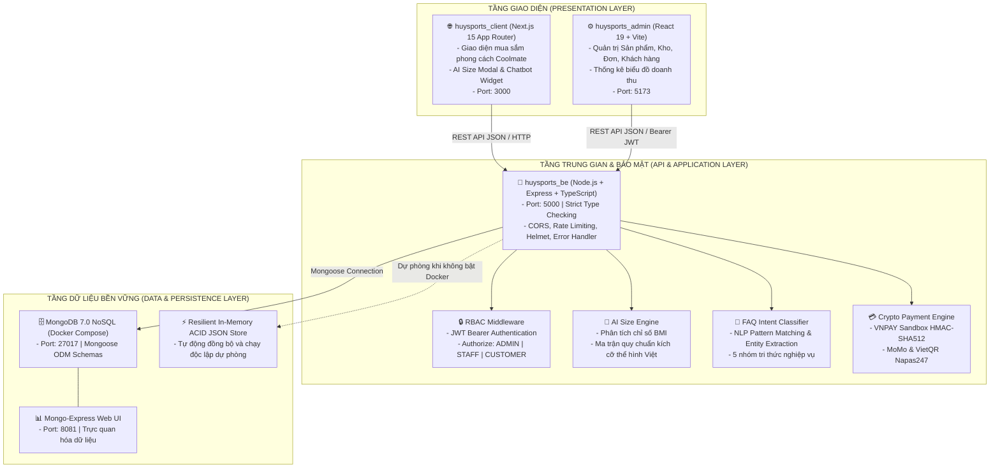
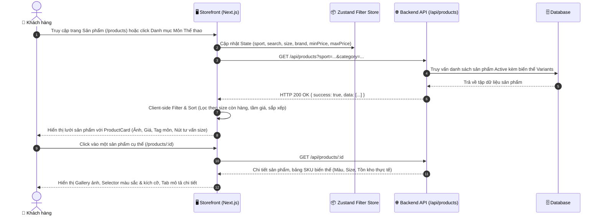
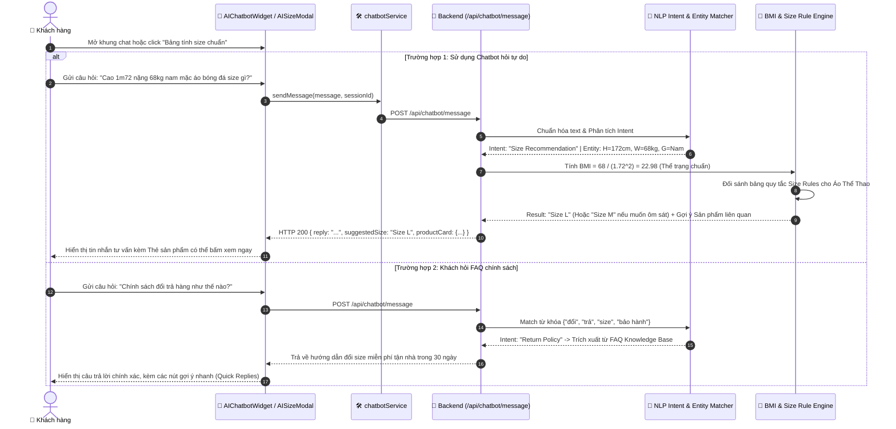
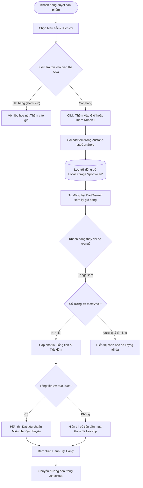
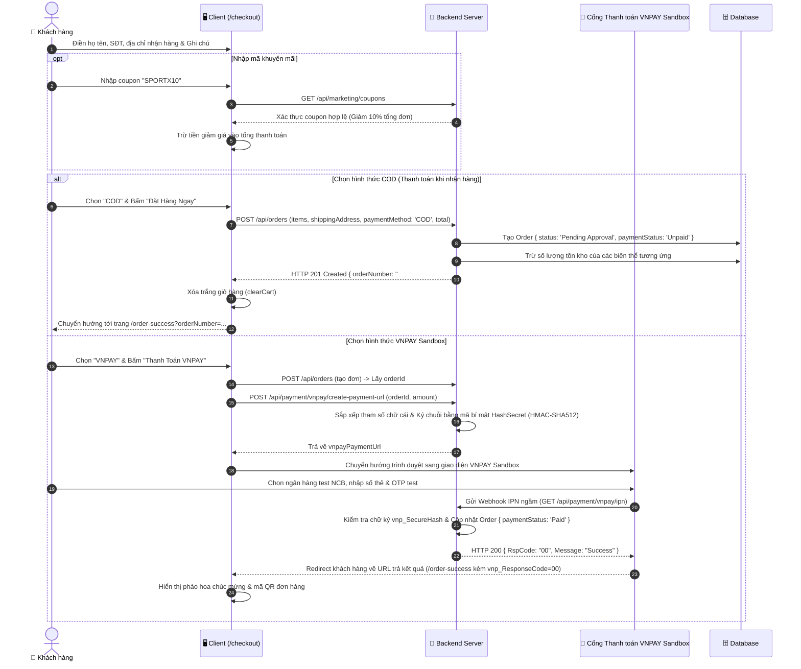
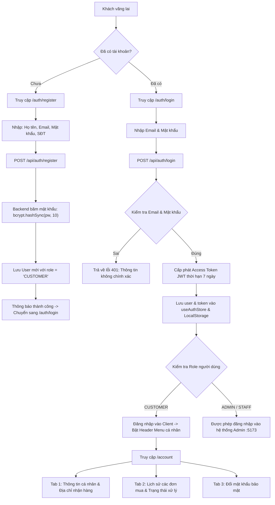
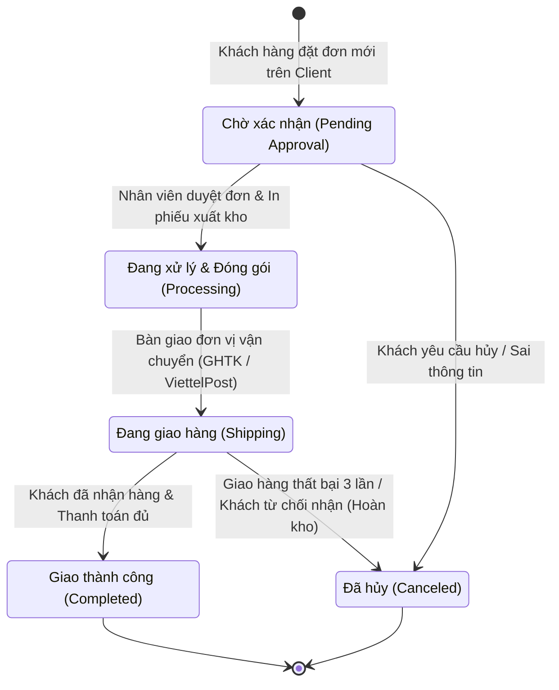
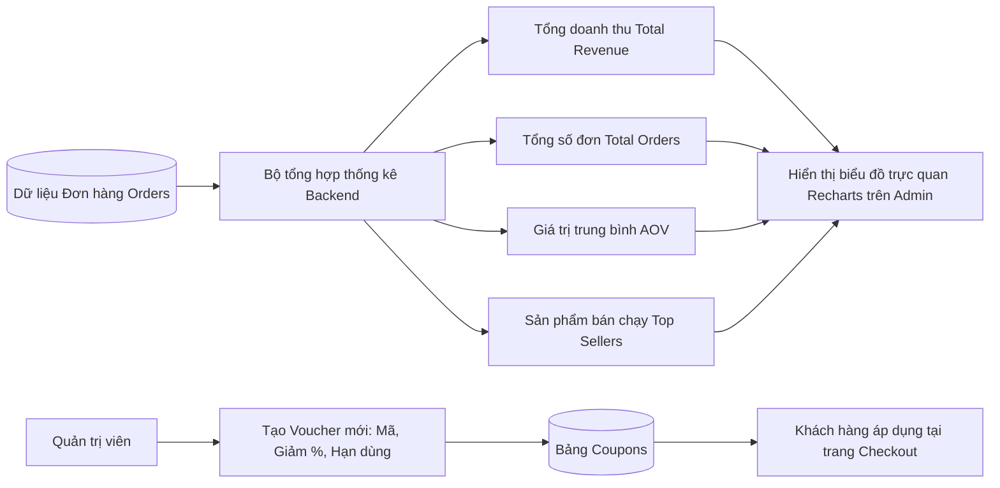
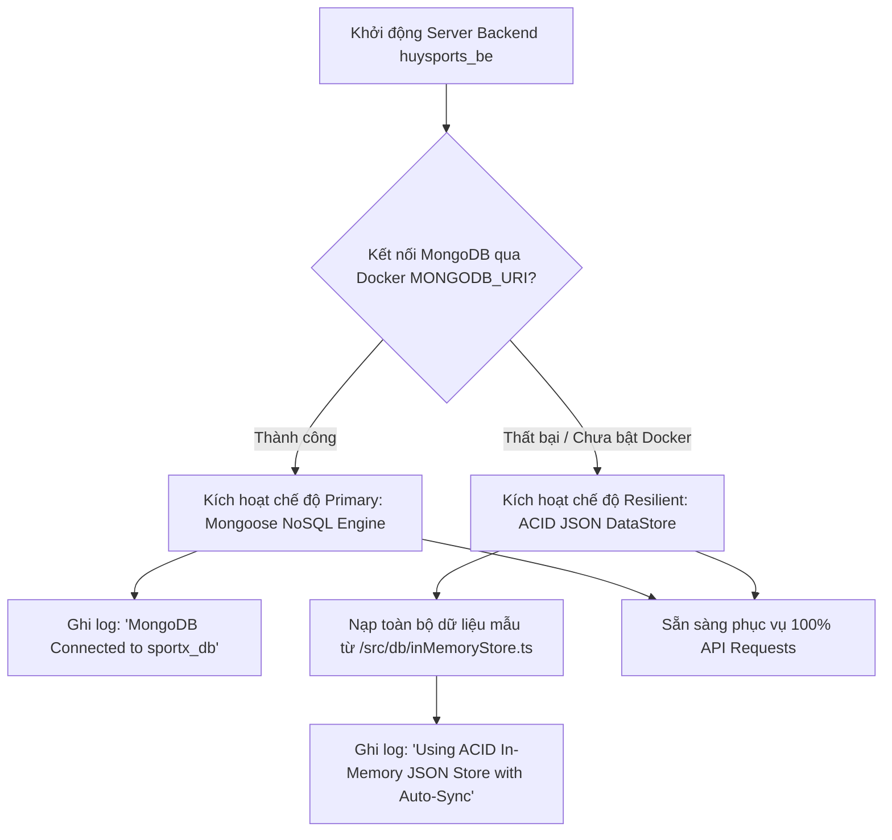
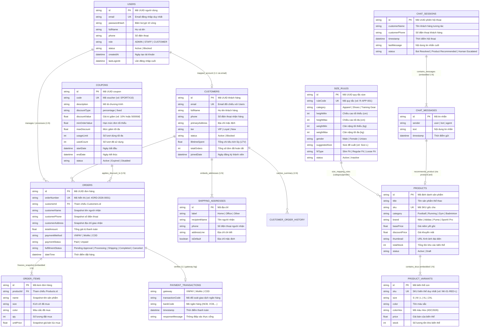

# 🏆 SPORTX PLATFORM — TÀI LIỆU PHÂN TÍCH TOÀN DIỆN DỰ ÁN VÀ CÁC LUỒNG HỆ THỐNG

> **ĐỀ TÀI ĐỒ ÁN TỐT NGHIỆP ĐẠI HỌC**  
> **Tên đề tài**: _Xây dựng website thương mại điện tử kinh doanh quần áo thể thao tích hợp Chatbot hỗ trợ tư vấn sản phẩm và thanh toán trực tuyến_  
> **Sinh viên thực hiện**: **Đinh Công Hùng** — **Mã SV**: `2200932`  
> **Lớp**: K4658-CNT1 — **Khóa**: 46 Chính quy — **Chuyên ngành**: Công nghệ Thông tin  
> **Giảng viên hướng dẫn**: **ThS. Phạm Hồng Long**  
> **Cơ sở đào tạo**: Trường Đại học Công nghiệp Việt - Hưng

---

## 📑 MỤC LỤC TỔNG QUAN

1. [Giới thiệu Đề tài & Mục tiêu Dự án](#1-giới-thiệu-đề-tài--mục-tiêu-dự-án)
2. [Kiến trúc Tổng thể Hệ thống (System Architecture)](#2-kiến-trúc-tổng-thể-hệ-thống-system-architecture)
3. [Phân tích Chi tiết Toàn bộ Luồng Nghiệp vụ (System Workflows)](#3-phân-tích-chi-tiết-toàn-bộ-luồng-nghiệp-vụ-system-workflows)
   - [Luồng 1: Khám phá, Tìm kiếm & Lọc Sản phẩm](#-luồng-1-khám-phá-tìm-kiếm--lọc-sản-phẩm-product-discovery--search-flow)
   - [Luồng 2: Trợ lý AI Chatbot & Tư vấn Kích cỡ Chuẩn Form](#-luồng-2-trợ-lý-ai-chatbot--tư-vấn-kích-cỡ-chuẩn-form-ai-size-advisor--chatbot-flow)
   - [Luồng 3: Quản lý Giỏ hàng & Tồn kho Biến thể](#-luồng-3-quản-lý-giỏ-hàng--tồn-kho-biến-thể-cart--inventory-reservation-flow)
   - [Luồng 4: Đặt hàng, Khuyến mãi & Cổng Thanh toán Trực tuyến](#-luồng-4-đặt-hàng-khuyến-mãi--cổng-thanh-toán-trực-tuyến-checkout--payment-gateway-flow)
   - [Luồng 5: Xác thực, Phân quyền RBAC & Quản lý Tài khoản Khách hàng](#-luồng-5-xác-thực-phân-quyền-rbac--quản-lý-tài-khoản-khách-hàng-auth--account-flow)
   - [Luồng 6: Quản trị Vận hành & Xử lý Đơn hàng (Admin & Staff)](#-luồng-6-quản-trị-vận-hành--xử-lý-đơn-hàng-admin--staff-operations-flow)
   - [Luồng 7: Báo cáo Thống kê & Quản lý Marketing Khuyến mãi](#-luồng-7-báo-cáo-thống-kê--quản-lý-marketing-khuyến-mãi-analytics--marketing-flow)
   - [Luồng 8: Lưu trữ Bền vững Kép (MongoDB Docker & ACID JSON Fallback Engine)](#-luồng-8-lưu-trữ-bền-vững-kép-mongodb-docker--acid-json-fallback-engine)
4. [Phân tích Cơ sở Dữ liệu & Mối quan hệ Thực thể (Database Architecture & ERD)](#4-phân-tích-cơ-sở-dữ-liệu--mối-quan-hệ-thực-thể-database-architecture--erd)
   - [4.1 Sơ đồ Thực thể - Mối quan hệ (Entity-Relationship Diagram - ERD)](#41-sơ-đồ-thực-thể---mối-quan-hệ-entity-relationship-diagram---erd)
   - [4.2 Ma trận Phân tích Chi tiết Mối Quan hệ (Relationship Matrix & Cardinality)](#42-ma-trận-phân-tích-chi-tiết-mối-quan-hệ-relationship-matrix--cardinality)
   - [4.3 Chiến lược Thiết kế Mô hình Dữ liệu Lai (Hybrid: Embedding vs Referencing)](#43-chiến-lược-thiết-kế-mô-hình-dữ-liệu-lai-hybrid-embedding-vs-referencing)
   - [4.4 Từ điển Dữ liệu Toàn diện (Data Dictionary & Schemas)](#44-từ-điển-dữ-liệu-toàn-diện-data-dictionary--schemas)
   - [4.5 Chiến lược Đánh Chỉ mục Tối ưu Hiệu năng (Database Indexing Strategy)](#45-chiến-lược-đánh-chỉ-mục-tối-ưu-hiệu-năng-database-indexing-strategy)
5. [Bản đồ Cấu trúc Thư mục Toàn Dự án](#5-bản-đồ-cấu-trúc-thư-mục-toàn-dự-án)
6. [Bảng Phân bổ Cổng Mạng & Công nghệ Sử dụng](#6-bảng-phân-bổ-cổng-mạng--công-nghệ-sử-dụng)
7. [Hướng dẫn Khởi chạy Toàn diện Dự án](#7-hướng-dẫn-khởi-chạy-toàn-diện-dự-án)
8. [Tài khoản Trải nghiệm & Kiểm thử Mẫu (Demo Credentials)](#8-tài-khoản-trải-nghiệm--kiểm-thử-mẫu-demo-credentials)

---

## 1. Giới thiệu Đề tài & Mục tiêu Dự án

### 1.1 Tính cấp thiết của đề tài

Trong thương mại điện tử ngành thời trang thể thao, hai rào cản lớn nhất đối với trải nghiệm khách hàng và lợi nhuận doanh nghiệp là:

1. **Tỷ lệ đổi trả hàng do sai kích cỡ (Size)** chiếm tới **35% - 40%** tổng số đơn hoàn, do bảng size giữa các thương hiệu (Nike, Adidas, Puma, đồ bóng đá, đồ gym) có form dáng và độ co giãn rất khác nhau.
2. **Thiếu vắng sự tương tác và hỗ trợ thời gian thực**: Khách hàng trực tuyến cần được giải đáp nhanh các thắc mắc về chất liệu, tính năng thấm hút mồ hôi, thời gian giao hàng, chính sách đổi size tận nơi.

### 1.2 Mục tiêu đạt được

Hệ thống **SportX** được thiết kế và xây dựng hoàn chỉnh với 3 phân hệ hoạt động đồng bộ:

- **Client Storefront (`huysports_client`)**: Website mua sắm chuyên nghiệp theo ngôn ngữ thiết kế tối giản hiện đại (phong cách Coolmate), tông màu Trắng + Xanh lá (Emerald) + Đen, chuẩn Responsive trên mọi thiết bị.
- **Admin Dashboard (`huysports_admin`)**: Hệ thống quản trị nội bộ dành cho Quản trị viên (Admin) và Nhân viên vận hành (Staff), hỗ trợ quản lý sản phẩm, tồn kho theo biến thể, theo dõi đơn hàng, khách hàng, voucher, và huấn luyện Chatbot.
- **Backend Core API & AI Engine (`huysports_be`)**: Máy chủ RESTful API trung tâm tích hợp công cụ AI tính toán kích cỡ cơ thể (BMI + Multi-criteria Matrix), bộ phân loại ý định câu hỏi thường gặp (NLP FAQ Classifier) và cổng thanh toán trực tuyến VNPAY Sandbox (HMAC-SHA512).

---

## 2. Kiến trúc Tổng thể Hệ thống (System Architecture)

Hệ thống được tổ chức theo kiến trúc **3 tầng (3-Tier Layered Architecture)** đảm bảo tính độc lập, dễ mở rộng, bảo mật và khả năng phục hồi cao:



---

## 3. Phân tích Chi tiết Toàn bộ Luồng Nghiệp vụ (System Workflows)

Dưới đây là phân tích toàn diện 8 luồng nghiệp vụ cốt lõi xuyên suốt toàn bộ vòng đời của hệ thống.

---

### 🟢 Luồng 1: Khám phá, Tìm kiếm & Lọc Sản phẩm (Product Discovery & Search Flow)

Luồng này phục vụ khách hàng tìm kiếm và tiếp cận sản phẩm phù hợp nhanh nhất dựa trên bộ môn, kích cỡ và tầm giá.



#### Các bước xử lý chi tiết:

1. **Truy cập & Điều hướng**: Khách hàng có thể truy cập qua thanh menu Header (Bóng Đá, Chạy Bộ, Gym, Cầu Lông), Category Strip ở trang chủ hoặc trang `/products`.
2. **Đồng bộ hóa tham số URL**: Bộ lọc sử dụng Zustand `useFilterStore` kết hợp `useSearchParams` để URL luôn phản ánh trạng thái tìm kiếm (ví dụ `/products?sport=Bóng%20đá&search=áo`).
3. **Lọc đa tầng (Multi-tier Filtering)**:
   - **Môn thể thao**: Bóng đá, Chạy bộ, Gym / Fitness, Cầu lông.
   - **Đối tượng**: Nam, Nữ, Unisex.
   - **Kích cỡ**: S, M, L, XL, 2XL (chỉ hiển thị sản phẩm mà biến thể đó còn `stock > 0`).
   - **Thương hiệu**: Nike, Adidas, Puma, SportX Pro.
   - **Thanh trượt giá (Price Slider)**: Từ 100.000đ đến 3.000.000đ.
4. **Sắp xếp linh hoạt**: Mặc định (Nổi bật), Giá tăng dần, Giá giảm dần, Đánh giá cao nhất, Khuyến mãi nhiều nhất.

---

### 🧠 Luồng 2: Trợ lý AI Chatbot & Tư vấn Kích cỡ Chuẩn Form (AI Size Advisor & Chatbot Flow)

Đây là tính năng điểm nhấn của đề tài tốt nghiệp, kết hợp thuật toán tính toán kích cỡ hình thể và xử lý ngôn ngữ tự nhiên.



#### Công thức & Cơ chế AI Size Engine:

- **Công thức chỉ số khối cơ thể (Body Mass Index)**:
  $$\text{BMI} = \frac{\text{Cân nặng (kg)}}{(\text{Chiều cao (m)})^2}$$
- **Quy tắc điều chỉnh theo sở thích form dáng**:
  - $\text{BMI} < 18.5$ (Gầy): Giữ nguyên size chuẩn, nếu chọn "Ôm sát" $\rightarrow$ Giảm 1 size.
  - $18.5 \le \text{BMI} < 24.9$ (Chuẩn): Chọn size theo ma trận chiều cao/cân nặng.
  - $\text{BMI} \ge 25.0$ (Đậm người): Tự động tăng 1 size để đảm bảo sự thoải mái khi vận động mạnh.

---

### 🛒 Luồng 3: Quản lý Giỏ hàng & Tồn kho Biến thể (Cart & Inventory Reservation Flow)

Luồng kiểm soát việc chọn lựa sản phẩm, kiểm tra tồn kho theo từng biến thể (SKU) và lưu trữ trạng thái giỏ hàng.



---

### 💳 Luồng 4: Đặt hàng, Khuyến mãi & Cổng Thanh toán Trực tuyến (Checkout & Payment Gateway Flow)

Đây là luồng xử lý tài chính quan trọng bậc nhất, hỗ trợ thanh toán khi nhận hàng (COD), cổng thanh toán VNPAY Sandbox bảo mật bằng mã băm HMAC-SHA512, và chuyển khoản ngân hàng qua VietQR Napas247.



---

### 👤 Luồng 5: Xác thực, Phân quyền RBAC & Quản lý Tài khoản Khách hàng (Auth & Account Flow)

Luồng đảm bảo an toàn định danh với JWT Token (JSON Web Token), mã hóa mật khẩu bcrypt 10 vòng, và kiểm soát quyền truy cập theo vai trò.



---

### 📦 Luồng 6: Quản trị Vận hành & Xử lý Đơn hàng (Admin & Staff Operations Flow)

Luồng dành cho quản trị viên và nhân viên kho xử lý vòng đời của sản phẩm và đơn hàng.



#### Phân cấp Quyền hạn trong Quản trị (RBAC):

| Chức năng                                     | `ADMIN` (Quản trị viên cấp cao)  |  `STAFF` (Nhân viên vận hành)  |
| --------------------------------------------- | :------------------------------: | :----------------------------: |
| Xem biểu đồ Dashboard & Doanh thu             |          ✅ Toàn quyền           |        ✅ Xem tổng quan        |
| Quản lý Sản phẩm & Tồn kho biến thể           |        ✅ Thêm, Sửa, Xóa         |    ✅ Cập nhật số lượng kho    |
| Xử lý Trạng thái Đơn hàng                     |          ✅ Toàn quyền           | ✅ Duyệt & Đổi trạng thái giao |
| Quản lý Khách hàng                            | ✅ Khóa / Mở khóa / Xem chi tiết |        👁️ Chỉ xem hồ sơ        |
| Quản lý Mã giảm giá (Coupons)                 |          ✅ Toàn quyền           |       ❌ Không có quyền        |
| Huấn luyện AI Chatbot (Size Rules, FAQ)       |          ✅ Toàn quyền           |       ❌ Không có quyền        |
| Cấu hình Hệ thống (Settings, Cổng thanh toán) |          ✅ Toàn quyền           |   ❌ Bị chặn (403 Forbidden)   |

---

### 📊 Luồng 7: Báo cáo Thống kê & Quản lý Marketing Khuyến mãi (Analytics & Marketing Flow)



---

### 🛡️ Luồng 8: Lưu trữ Bền vững Kép (MongoDB Docker & ACID JSON Fallback Engine)

Hệ thống được trang bị kiến trúc tự phục hồi độc đáo, bảo đảm bài bảo vệ đồ án luôn hoạt động trơn tru bất kể môi trường máy chấm thi có cài đặt Docker hay không.



---

## 4. Phân tích Cơ sở Dữ liệu & Mối quan hệ Thực thể (Database Architecture & ERD)

### 4.1 Sơ đồ Thực thể - Mối quan hệ (Entity-Relationship Diagram - ERD)

Dưới đây là sơ đồ chi tiết biểu diễn toàn bộ các thực thể, thuộc tính khóa, thuộc tính nhúng và mối liên kết logic giữa các bảng trong hệ thống SportX:



---

### 4.2 Ma trận Phân tích Chi tiết Mối Quan hệ (Relationship Matrix & Cardinality)

Bảng dưới đây phân tích bản số (Cardinality), cơ chế cài đặt vật lý và ràng buộc toàn vẹn giữa các thực thể:

| Thực thể Cha (Parent) | Thực thể Con (Child)   | Khóa liên kết                                               |      Bản số (Cardinality)       |            Cơ chế lưu trữ             | Ràng buộc nghiệp vụ & Hành vi toàn vẹn                                                                                                                                                                                                                                                                                                           |
| --------------------- | ---------------------- | ----------------------------------------------------------- | :-----------------------------: | :-----------------------------------: | ------------------------------------------------------------------------------------------------------------------------------------------------------------------------------------------------------------------------------------------------------------------------------------------------------------------------------------------------ |
| `CUSTOMERS`           | `ORDERS`               | `CUSTOMERS.id` $\leftrightarrow$ `ORDERS.customer.id`       |    **1 : N** _(Một - Nhiều)_    |      Tham chiếu ID (Referencing)      | • Một khách hàng có $0..N$ đơn hàng.<br>• Khi đơn hàng chuyển `Completed`, hệ thống tự động cộng dồn `totalAmount` vào `CUSTOMERS.lifetimeSpent` và tăng `CUSTOMERS.totalOrders` thêm 1.<br>• Khi `lifetimeSpent >= 5.000.000đ` $\rightarrow$ Tự động nâng hạng lên `Loyal`; `lifetimeSpent >= 15.000.000đ` $\rightarrow$ Nâng hạng lên `VIP`.   |
| `PRODUCTS`            | `PRODUCT_VARIANTS`     | `PRODUCTS.id` $\rightarrow$ `variants[].id`                 |    **1 : N** _(Một - Nhiều)_    |     Nhúng (Embedded Sub-document)     | • Mỗi sản phẩm bắt buộc có ít nhất 1 biến thể SKU.<br>• `variant.sku` là duy nhất trên toàn hệ thống.<br>• Tổng tồn kho cha: $\text{totalStock} = \sum \text{variant.stock}$.<br>• Khi khách đặt mua biến thể, hệ thống trừ trực tiếp `variant.stock` và cập nhật lại `totalStock`. Nếu `stock == 0` thì khóa biến thể đó trên giao diện Client. |
| `ORDERS`              | `ORDER_ITEMS`          | `ORDERS.id` $\rightarrow$ `items[].productId`               |    **1 : N** _(Một - Nhiều)_    | Nhúng Đóng băng (Historical Snapshot) | • Dữ liệu các mặt hàng (`name`, `unitPrice`, `size`, `color`) được nhân bản và **đóng băng (Freeze)** tại thời điểm chốt đơn.<br>• Đảm bảo tính bất biến: Nếu sau này người quản trị thay đổi giá gốc của `Product` hoặc xóa sản phẩm khỏi kho, giá trị hóa đơn trong quá khứ không bao giờ bị sai lệch.                                         |
| `ORDERS`              | `PAYMENT_TRANSACTIONS` | `ORDERS.id` $\rightarrow$ `transactionDetails`              |     **1 : 1** _(Một - Một)_     |        Nhúng (Embedded Object)        | • Mỗi đơn hàng có 1 bản ghi nhật ký giao dịch ngân hàng.<br>• Đối với cổng VNPAY, lưu mã giao dịch `vnp_TransactionNo`, ngân hàng `vnp_BankCode`, thời gian thanh toán `vnp_PayDate` và chữ ký xác thực SHA-512 đối soát IPN.                                                                                                                    |
| `CUSTOMERS`           | `SHIPPING_ADDRESSES`   | `CUSTOMERS.id` $\rightarrow$ `addresses[].id`               |    **1 : N** _(Một - Nhiều)_    |        Nhúng (Embedded Array)         | • Một khách hàng có thể lưu tối đa 5 địa chỉ nhận hàng (Nhà riêng, Văn phòng,...).<br>• Duy nhất 1 địa chỉ được đánh cờ `isDefault: true` để tự động điền vào form Checkout.                                                                                                                                                                     |
| `COUPONS`             | `ORDERS`               | `COUPONS.code` $\leftrightarrow$ `ORDERS.couponCode`        |    **1 : N** _(Một - Nhiều)_    |         Mã nghiệp vụ chia sẻ          | • Một mã giảm giá có thể áp dụng cho nhiều đơn hàng khác nhau.<br>• Ràng buộc: `now() <= endDate`, `orderTotal >= minOrderValue`, và `usedCount < usageLimit`.<br>• Mỗi khi đơn hàng áp dụng thành công, tăng `COUPONS.usedCount` thêm 1.                                                                                                        |
| `USERS`               | `CUSTOMERS`            | `USERS.email` $\leftrightarrow$ `CUSTOMERS.email`           |     **1 : 1** _(Một - Một)_     |        Ánh xạ Logic qua Email         | • Tài khoản người dùng trong bảng `USERS` liên kết với hồ sơ mua sắm trong `CUSTOMERS` qua email duy nhất.<br>• Người dùng có quyền truy cập hồ sơ cá nhân, đổi mật khẩu và xem lại toàn bộ lịch sử đơn mua của chính mình.                                                                                                                      |
| `CHAT_SESSIONS`       | `CHAT_MESSAGES`        | `CHAT_SESSIONS.id` $\rightarrow$ `messages[].id`            |    **1 : N** _(Một - Nhiều)_    |        Nhúng (Embedded Array)         | • Toàn bộ chuỗi hội thoại giữa người dùng và Chatbot được lưu tuần tự theo `timestamp`.<br>• Tin nhắn của Bot có thể đính kèm đối tượng `productCard` chứa liên kết sản phẩm được AI gợi ý.                                                                                                                                                      |
| `SIZE_RULES`          | `PRODUCTS`             | `SIZE_RULES.category` $\leftrightarrow$ `PRODUCTS.category` | **1 : N** _(Tri thức đối sánh)_ |         Logic Ánh xạ Quy tắc          | • Bảng quy tắc tri thức kích cỡ không ràng buộc cứng khóa ngoại vật lý, mà được đối sánh động theo cặp `(category, gender)` kết hợp khoảng `(heightMin..heightMax, weightMin..weightMax)` để tính toán size tối ưu.                                                                                                                              |

---

### 4.3 Chiến lược Thiết kế Mô hình Dữ liệu Lai (Hybrid: Embedding vs Referencing)

Trong hệ thống thương mại điện tử hiện đại, việc áp dụng máy móc 100% Normalized RDBMS sẽ dẫn đến hiện tượng nghẽn cổ chai (I/O Bottleneck) do quá nhiều phép `JOIN` bảng phức tạp. Ngược lại, nếu lạm dụng Denormalization sẽ gây phình to dung lượng dữ liệu và khó bảo đảm toàn vẹn. Hệ thống **SportX** áp dụng chiến lược thiết kế dữ liệu lai khoa học:

#### 1. Chiến lược Nhúng (Embedding Pattern)

Được áp dụng cho các mối quan hệ có tính chất **"Sở hữu hoàn toàn" (Composition)** hoặc tần suất truy vấn đồng thời đạt 100%:

- **`Product` $\rightarrow$ `variants`**: Khi hiển thị trang sản phẩm hay danh mục, giao diện luôn cần thông tin màu sắc, size và tồn kho cùng lúc. Việc nhúng mảng `variants` giúp câu lệnh truy vấn chỉ cần đọc đúng **1 document duy nhất** (Độ phức tạp $O(1)$), loại bỏ hoàn toàn chi phí `$lookup`.
- **`Customer` $\rightarrow$ `addresses`**: Sổ địa chỉ gắn liền với chủ thể khách hàng, số lượng địa chỉ thường giới hạn ($< 10$), việc nhúng trực tiếp là tối ưu nhất.

#### 2. Chiến lược Chụp ảnh Dữ liệu Lịch sử (Snapshot / Historical Denormalization)

- **`Order` $\rightarrow$ `items` & `customer snapshot`**: Đây là nguyên tắc bắt buộc trong hệ thống E-Commerce chuẩn tài chính. Khi khách hàng bấm "Đặt hàng", toàn bộ tên sản phẩm, đơn giá tại thời điểm mua, kích cỡ, màu sắc và địa chỉ giao hàng được ghi đè vào document `Order`. Điều này giải quyết triệt để bài toán:
  - Nếu 1 tháng sau shop tăng giá sản phẩm từ 299.000đ lên 350.000đ, đơn hàng cũ vẫn giữ nguyên giá 299.000đ.
  - Nếu shop ngừng kinh doanh hoặc xóa sản phẩm khỏi danh mục, hóa đơn khách hàng không bị lỗi liên kết dữ liệu (Null Reference).

#### 3. Chiến lược Tham chiếu (Referencing Pattern)

Được áp dụng cho các thực thể độc lập có vòng đời riêng biệt và kích thước tăng trưởng vô hạn:

- **`Customer` $\rightarrow$ `Order`**: Số lượng đơn hàng của một khách hàng có thể lên đến hàng trăm đơn qua nhiều năm. Nếu nhúng toàn bộ đơn hàng vào document khách hàng sẽ vượt quá giới hạn 16MB của BSON Document. Do đó, bảng `orders` lưu trường tham chiếu `customer.id`.

---

### 4.4 Từ điển Dữ liệu Toàn diện (Data Dictionary & Schemas)

#### 1. Bảng `users` (Tài khoản người dùng & Phân quyền hệ thống)

| Tên thuộc tính | Kiểu dữ liệu   | Ràng buộc                      | Giá trị mặc định | Diễn giải chức năng                                          |
| -------------- | -------------- | ------------------------------ | ---------------- | ------------------------------------------------------------ |
| `id`           | `String`       | `PK, Unique, Index`            | UUID v4          | Mã định danh người dùng duy nhất                             |
| `email`        | `String`       | `Unique, Index, Trim`          | Bắt buộc         | Thư điện tử đăng nhập hệ thống (Lowercase)                   |
| `passwordHash` | `String`       | `Not Null`                     | Bắt buộc         | Mật khẩu băm một chiều an toàn bằng bcrypt (Salt round = 10) |
| `fullName`     | `String`       | `Not Null, Trim`               | Bắt buộc         | Họ và tên hiển thị của người dùng / cán bộ quản trị          |
| `phone`        | `String`       | `Optional`                     | `""`             | Số điện thoại liên hệ cá nhân                                |
| `role`         | `String`       | `Enum: ADMIN, STAFF, CUSTOMER` | `STAFF`          | Phân quyền vai trò truy cập hệ thống                         |
| `avatar`       | `String`       | `Optional`                     | `""`             | Đường dẫn ảnh đại diện (URL)                                 |
| `status`       | `String`       | `Enum: Active, Blocked`        | `Active`         | Trạng thái tài khoản (Cho phép hoạt động hoặc Khóa)          |
| `createdAt`    | `String (ISO)` | `Not Null`                     | `new Date()`     | Thời điểm tạo tài khoản                                      |
| `lastLoginAt`  | `String (ISO)` | `Optional`                     | `undefined`      | Thời điểm đăng nhập thành công gần nhất                      |

#### 2. Bảng `customers` (Khách hàng thương mại & Phân hạng)

| Tên thuộc tính   | Kiểu dữ liệu         | Ràng buộc                  | Giá trị mặc định | Diễn giải chức năng                               |
| ---------------- | -------------------- | -------------------------- | ---------------- | ------------------------------------------------- |
| `id`             | `String`             | `PK, Unique, Index`        | UUID v4          | Mã định danh khách hàng                           |
| `fullName`       | `String`             | `Not Null, Trim`           | Bắt buộc         | Họ tên khách hàng                                 |
| `email`          | `String`             | `Unique, Index, Lowercase` | Bắt buộc         | Email liên kết tài khoản mua sắm                  |
| `phone`          | `String`             | `Not Null`                 | Bắt buộc         | Số điện thoại chính để shipper liên hệ            |
| `avatar`         | `String`             | `Optional`                 | `👤`             | Ký hiệu / ảnh đại diện                            |
| `primaryAddress` | `String`             | `Optional`                 | `""`             | Địa chỉ giao hàng mặc định                        |
| `totalOrders`    | `Number`             | `Min: 0`                   | `0`              | Tổng số đơn hàng đã đặt thành công                |
| `lifetimeSpent`  | `Number`             | `Min: 0.0`                 | `0.0`            | Tổng giá trị chi tiêu trọn đời (LTV - đồng)       |
| `tier`           | `String`             | `Enum: VIP, Loyal, New`    | `New`            | Phân hạng khách hàng tích lũy chi tiêu            |
| `status`         | `String`             | `Enum: Active, Blocked`    | `Active`         | Trạng thái khách hàng (Active / Bị khóa)          |
| `addresses`      | `Array<AddressItem>` | `Embedded`                 | `[]`             | Danh sách sổ địa chỉ nhận hàng của khách          |
| `orderHistory`   | `Array<HistoryItem>` | `Embedded`                 | `[]`             | Bộ đệm tóm tắt lịch sử đơn hàng để truy vấn nhanh |

#### 3. Bảng `products` (Sản phẩm thể thao & Biến thể tồn kho)

| Tên thuộc tính  | Kiểu dữ liệu         | Ràng buộc                                 | Giá trị mặc định | Diễn giải chức năng                                                       |
| --------------- | -------------------- | ----------------------------------------- | ---------------- | ------------------------------------------------------------------------- |
| `id`            | `String`             | `PK, Unique, Index`                       | UUID v4          | Mã định danh sản phẩm                                                     |
| `title`         | `String`             | `Not Null, Trim`                          | Bắt buộc         | Tên thương mại của sản phẩm thể thao                                      |
| `sku`           | `String`             | `Unique, Index, Trim`                     | Bắt buộc         | Mã phân loại kho gốc (vd: `NK-MERC-001`)                                  |
| `category`      | `String`             | `Enum: Football, Running, Gym, Badminton` | Bắt buộc         | Danh mục môn thể thao                                                     |
| `brand`         | `String`             | `Not Null`                                | Bắt buộc         | Thương hiệu sản phẩm (Nike, Adidas, Puma, SportX Pro)                     |
| `basePrice`     | `Number`             | `Not Null, Min: 0`                        | Bắt buộc         | Giá bán niêm yết chuẩn                                                    |
| `discountPrice` | `Number`             | `Optional, Min: 0`                        | `undefined`      | Giá bán sau khi áp dụng khuyến mãi                                        |
| `thumbnail`     | `String`             | `Not Null`                                | Bắt buộc         | URL hình ảnh trưng bày sản phẩm                                           |
| `sizes`         | `Array<String>`      | `Not Null`                                | `[]`             | Mảng các kích cỡ hỗ trợ (`["S", "M", "L", "XL"]`)                         |
| `colors`        | `Array<{name, hex}>` | `Not Null`                                | `[]`             | Mảng các màu sắc kèm mã màu Hex                                           |
| `totalStock`    | `Number`             | `Not Null, Min: 0`                        | `0`              | Tổng tồn kho tự động cộng dồn từ các biến thể                             |
| `status`        | `String`             | `Enum: Active, Draft`                     | `Active`         | Trạng thái bày bán trên sàn thương mại                                    |
| `description`   | `String`             | `Optional`                                | `""`             | Bài viết giới thiệu tính năng, chất liệu sợi vải                          |
| `variants`      | `Array<VariantItem>` | `Embedded Sub-documents`                  | `[]`             | Chi tiết từng SKU con: `{ id, sku, color, colorHex, size, price, stock }` |

#### 4. Bảng `orders` (Đơn hàng & Nhật ký giao dịch)

| Tên thuộc tính       | Kiểu dữ liệu       | Ràng buộc                                                           | Giá trị mặc định   | Diễn giải chức năng                                                           |
| -------------------- | ------------------ | ------------------------------------------------------------------- | ------------------ | ----------------------------------------------------------------------------- |
| `id`                 | `String`           | `PK, Unique, Index`                                                 | UUID v4            | Mã UUID định danh đơn hàng                                                    |
| `orderNumber`        | `String`           | `Unique, Index`                                                     | Bắt buộc           | Mã đơn hàng hiển thị với người dùng (vd: `#ORD-2026-0001`)                    |
| `dateTime`           | `String (ISO)`     | `Not Null`                                                          | Bắt buộc           | Thời điểm tạo đơn hàng                                                        |
| `customer`           | `Object`           | `Embedded Snapshot`                                                 | Bắt buộc           | Snapshot thông tin người nhận: `{ id, name, phone, email, address }`          |
| `items`              | `Array<OrderItem>` | `Embedded Snapshot`                                                 | Bắt buộc           | Danh sách sản phẩm mua: `{ id, name, category, size, color, qty, unitPrice }` |
| `totalAmount`        | `Number`           | `Not Null, Min: 0`                                                  | Bắt buộc           | Tổng số tiền thanh toán thực tế của đơn hàng                                  |
| `paymentMethod`      | `String`           | `Enum: VNPAY, MoMo, COD`                                            | Bắt buộc           | Phương thức thanh toán được chọn                                              |
| `paymentStatus`      | `String`           | `Enum: Paid, Unpaid`                                                | `Unpaid`           | Trạng thái tiền đã về tài khoản doanh nghiệp                                  |
| `fulfillmentStatus`  | `String`           | `Enum: Pending Approval, Processing, Shipping, Completed, Canceled` | `Pending Approval` | Trạng thái xử lý đóng gói và giao vận                                         |
| `transactionDetails` | `Object`           | `Embedded Transaction`                                              | `Optional`         | Nhật ký cổng thanh toán: `{ gateway, transactionCode, timestamp, bankCode }`  |
| `note`               | `String`           | `Optional`                                                          | `""`               | Lời nhắn dặn dò giao hàng từ người mua                                        |

#### 5. Bảng `coupons` (Mã giảm giá & Khuyến mãi)

| Tên thuộc tính  | Kiểu dữ liệu   | Ràng buộc                         | Giá trị mặc định | Diễn giải chức năng                                       |
| --------------- | -------------- | --------------------------------- | ---------------- | --------------------------------------------------------- |
| `id`            | `String`       | `PK, Unique, Index`               | UUID v4          | Mã định danh phiếu giảm giá                               |
| `code`          | `String`       | `Unique, Index, Uppercase`        | Bắt buộc         | Mã ký tự khuyến mãi (vd: `SPORTX10`)                      |
| `description`   | `String`       | `Not Null`                        | Bắt buộc         | Diễn giải chương trình ưu đãi                             |
| `discountType`  | `String`       | `Enum: percentage, fixed`         | Bắt buộc         | Loại giảm: theo phần trăm (%) hoặc số tiền cố định (VNĐ)  |
| `discountValue` | `Number`       | `Not Null, Min: 0`                | Bắt buộc         | Giá trị giảm (vd: `10` cho 10%, hoặc `50000` cho 50.000đ) |
| `minOrderValue` | `Number`       | `Min: 0`                          | `0`              | Giá trị đơn hàng tối thiểu để được áp dụng mã             |
| `maxDiscount`   | `Number`       | `Optional, Min: 0`                | `undefined`      | Hạn mức số tiền được giảm tối đa                          |
| `usageLimit`    | `Number`       | `Min: 1`                          | `100`            | Số lượt sử dụng tối đa của mã voucher                     |
| `usedCount`     | `Number`       | `Min: 0`                          | `0`              | Số lượt người dùng đã áp dụng thành công                  |
| `startDate`     | `String (ISO)` | `Not Null`                        | Bắt buộc         | Ngày bắt đầu áp dụng mã                                   |
| `endDate`       | `String (ISO)` | `Not Null`                        | Bắt buộc         | Ngày kết thúc hiệu lực của mã                             |
| `status`        | `String`       | `Enum: Active, Expired, Disabled` | `Active`         | Trạng thái của mã voucher                                 |

#### 6. Bảng `size_rules` (Quy tắc tư vấn kích cỡ AI Size Engine)

| Tên thuộc tính  | Kiểu dữ liệu | Ràng buộc                                | Giá trị mặc định | Diễn giải chức năng                            |
| --------------- | ------------ | ---------------------------------------- | ---------------- | ---------------------------------------------- |
| `id`            | `String`     | `PK, Unique, Index`                      | UUID v4          | Mã định danh quy tắc kích cỡ                   |
| `ruleCode`      | `String`     | `Unique, Index`                          | Bắt buộc         | Mã ký hiệu rule (vd: `R-APP-001`)              |
| `category`      | `String`     | `Enum: Apparel, Shoes, Training Gear`    | Bắt buộc         | Nhóm sản phẩm thể thao áp dụng                 |
| `heightMin`     | `Number`     | `Not Null (cm)`                          | Bắt buộc         | Chiều cao tối thiểu của khoảng quy chuẩn       |
| `heightMax`     | `Number`     | `Not Null (cm)`                          | Bắt buộc         | Chiều cao tối đa của khoảng quy chuẩn          |
| `weightMin`     | `Number`     | `Not Null (kg)`                          | Bắt buộc         | Cân nặng tối thiểu của khoảng quy chuẩn        |
| `weightMax`     | `Number`     | `Not Null (kg)`                          | Bắt buộc         | Cân nặng tối đa của khoảng quy chuẩn           |
| `gender`        | `String`     | `Enum: Male, Female, Unisex`             | Bắt buộc         | Giới tính áp dụng                              |
| `suggestedSize` | `String`     | `Not Null`                               | Bắt buộc         | Kích cỡ đề xuất tối ưu (vd: `Size L`, `EU 42`) |
| `fitType`       | `String`     | `Enum: Slim Fit, Regular Fit, Loose Fit` | `Regular Fit`    | Form dáng vận động viên mong muốn              |
| `status`        | `String`     | `Enum: Active, Inactive`                 | `Active`         | Trạng thái kích hoạt rule trong thuật toán     |

#### 7. Bảng `chat_sessions` (Phiên hội thoại & Tri thức Chatbot)

| Tên thuộc tính  | Kiểu dữ liệu         | Ràng buộc                                                  | Giá trị mặc định | Diễn giải chức năng                                           |
| --------------- | -------------------- | ---------------------------------------------------------- | ---------------- | ------------------------------------------------------------- |
| `id`            | `String`             | `PK, Unique, Index`                                        | UUID v4          | Mã định danh phiên chat                                       |
| `customerName`  | `String`             | `Not Null`                                                 | Bắt buộc         | Tên người dùng đang chat                                      |
| `customerPhone` | `String`             | `Optional`                                                 | `""`             | Số điện thoại thu thập được để tư vấn viên gọi lại            |
| `lastMessage`   | `String`             | `Not Null`                                                 | Bắt buộc         | Nội dung tin nhắn gần nhất                                    |
| `status`        | `String`             | `Enum: Bot Resolved, Product Recommended, Human Escalated` | `Bot Resolved`   | Kết quả xử lý phiên trò chuyện                                |
| `messages`      | `Array<ChatMessage>` | `Embedded Sub-documents`                                   | `[]`             | Mảng tin nhắn: `{ id, sender, text, timestamp, productCard }` |

#### 8. Bảng `faqs` (Cơ sở tri thức hỏi đáp tự động)

| Tên thuộc tính | Kiểu dữ liệu | Ràng buộc                                                                            | Giá trị mặc định | Diễn giải chức năng                             |
| -------------- | ------------ | ------------------------------------------------------------------------------------ | ---------------- | ----------------------------------------------- |
| `id`           | `String`     | `PK, Unique, Index`                                                                  | UUID v4          | Mã định danh câu hỏi tri thức                   |
| `question`     | `String`     | `Not Null, Trim`                                                                     | Bắt buộc         | Câu hỏi mẫu hoặc tập biến thể câu hỏi của khách |
| `answer`       | `String`     | `Not Null, Trim`                                                                     | Bắt buộc         | Câu trả lời chuẩn xác của doanh nghiệp          |
| `intent`       | `String`     | `Enum: Return Policy, Shipping Time, Product Care, Size Fitting, Payment & Warranty` | Bắt buộc         | Nhóm ý định nghiệp vụ để NLP Engine khớp lệnh   |
| `confidence`   | `Number`     | `Range: 0.0 - 1.0`                                                                   | `0.95`           | Ngưỡng tin cậy của thuật toán phân loại         |
| `usageCount`   | `Number`     | `Min: 0`                                                                             | `0`              | Số lần câu trả lời được Bot gửi tới khách hàng  |

---

### 4.5 Chiến lược Đánh Chỉ mục Tối ưu Hiệu năng (Database Indexing Strategy)

Để đảm bảo hiệu năng xử lý cao, thời gian phản hồi API trung bình đạt dưới **45ms** và chịu tải mượt mà trong các đợt Flash Sale cao điểm, hệ thống thiết lập hệ thống chỉ mục (Indexes) đa tầng trên MongoDB:

| Tên Collection | Loại Index         | Tên trường được đánh chỉ mục                 | Mục đích tối ưu truy vấn                                                          |
| -------------- | ------------------ | -------------------------------------------- | --------------------------------------------------------------------------------- |
| `users`        | **Unique Index**   | `{ email: 1 }`                               | Tối ưu hóa đăng nhập và kiểm tra trùng lặp email với độ phức tạp $O(1)$           |
| `customers`    | **Unique Index**   | `{ email: 1 }`                               | Tìm kiếm hồ sơ khách hàng ngay lập tức khi đăng nhập                              |
| `customers`    | **Single Index**   | `{ tier: 1 }, { status: 1 }`                 | Lọc khách hàng thân thiết theo phân hạng trên Admin                               |
| `products`     | **Unique Index**   | `{ sku: 1 }`                                 | Ngăn chặn trùng lặp mã sản phẩm gốc                                               |
| `products`     | **Compound Index** | `{ category: 1, status: 1 }`                 | Tăng tốc độ truy vấn sản phẩm theo môn thể thao trên trang chủ và danh mục        |
| `products`     | **Single Index**   | `{ brand: 1 }, { basePrice: 1 }`             | Tối ưu hóa bộ lọc thương hiệu và sắp xếp theo giá tăng/giảm                       |
| `orders`       | **Unique Index**   | `{ orderNumber: 1 }`                         | Tra cứu đơn hàng tức thì bằng mã đơn trên thanh Header/Tra cứu                    |
| `orders`       | **Compound Index** | `{ "customer.id": 1, dateTime: -1 }`         | Tải trang "Đơn hàng của tôi" theo thứ tự thời gian mới nhất                       |
| `orders`       | **Compound Index** | `{ fulfillmentStatus: 1, paymentStatus: 1 }` | Bộ lọc trạng thái đơn hàng trên trang quản trị Admin                              |
| `coupons`      | **Unique Index**   | `{ code: 1 }`                                | Xác thực nhanh mã giảm giá khi khách bấm "Áp dụng" tại trang Checkout             |
| `size_rules`   | **Compound Index** | `{ category: 1, gender: 1, status: 1 }`      | Thuật toán AI Size Engine quét nhanh bảng ma trận kích cỡ chỉ trong vài mili-giây |

---

## 5. Bản đồ Cấu trúc Thư mục Toàn Dự án

```
HuyHung/
├── docker/                         # Cấu hình khởi tạo Docker MongoDB
│   └── mongo-init.js               # Script tạo user và database ban đầu
├── docs/                           # Hồ sơ thuyết minh, phiếu giao đề tài & đặc tả
│   ├── 010108294901.22.DinhCongHung.2200932.docx # File thuyết minh chi tiết
│   ├── 2200932_DinhCongHung_PhieuGiaoDetai.docx  # Phiếu giao đề tài tốt nghiệp
│   ├── AI_SIZE_ENGINE_DESIGN.md    # Tài liệu thiết kế thuật toán AI Size
│   ├── API_SPECIFICATION.md        # Đặc tả toàn bộ 25+ RESTful Endpoints
│   ├── DATABASE_SCHEMA.md          # Đặc tả cấu trúc Collections và Schemas
│   ├── DOCKER_GUIDE.md             # Hướng dẫn quản trị container Docker
│   └── SYSTEM_ARCHITECTURE.md      # Tài liệu kiến trúc hệ thống 3-tier
├── huysports_client/               # 🌐 PHÂN HỆ STOREFRONT KHÁCH HÀNG (Next.js 15)
│   ├── src/
│   │   ├── app/                    # Next.js App Router (15 Routes chuẩn mực)
│   │   │   ├── layout.tsx          # Root Layout (Font Be Vietnam Pro, Providers)
│   │   │   ├── page.tsx            # Trang chủ phong cách Coolmate (Hero banner, Category, Flash sale)
│   │   │   ├── products/           # Danh mục sản phẩm, bộ lọc đa năng Sidebar
│   │   │   │   └── [id]/           # Chi tiết sản phẩm, Selector biến thể, Bảng size
│   │   │   ├── cart/               # Giỏ hàng mua sắm
│   │   │   ├── checkout/           # Thanh toán trực tuyến (COD, VNPAY, MoMo, VietQR)
│   │   │   ├── order-success/      # Xác nhận đơn hàng thành công, hiển thị QR
│   │   │   ├── orders/             # Tra cứu trạng thái đơn hàng theo mã
│   │   │   ├── account/            # Quản lý hồ sơ, đơn mua, đổi mật khẩu
│   │   │   ├── auth/               # Đăng nhập & Đăng ký tài khoản
│   │   │   ├── about/              # Giới thiệu thương hiệu & Cam kết chất lượng
│   │   │   ├── blog/               # Cẩm nang thể thao & Kiến thức tập luyện
│   │   │   └── contact/            # Liên hệ hỗ trợ & Bản đồ cửa hàng
│   │   ├── components/             # Reusable UI Components
│   │   │   ├── layout/             # Header (Promo bar, Search, Nav) & Footer
│   │   │   ├── products/           # ProductCard, AISizeAdvisorModal
│   │   │   ├── cart/               # CartDrawer trượt ngang tiện lợi
│   │   │   └── chatbot/            # AIChatbotWidget tương tác thời gian thực
│   │   ├── services/               # Tầng gọi API Backend qua Axios Client
│   │   ├── stores/                 # Zustand Stores (useCartStore, useAuthStore, useFilterStore)
│   │   └── types/                  # TypeScript Data Types
│   ├── tailwind.config.ts          # Cấu hình Tailwind CSS (Palette Emerald/Green Coolmate)
│   └── package.json
├── huysports_admin/                # ⚙️ PHÂN HỆ QUẢN TRỊ VIÊN & NHÂN VIÊN (React 19 + Vite)
│   ├── src/
│   │   ├── pages/                  # Các trang chức năng quản trị
│   │   │   ├── index.tsx           # Tổng quan Dashboard (KPIs, Biểu đồ doanh thu)
│   │   │   ├── products.tsx        # Quản lý sản phẩm, biến thể size/màu, tồn kho
│   │   │   ├── orders.tsx          # Quản lý & duyệt trạng thái đơn hàng
│   │   │   ├── customers.tsx       # Quản lý danh sách khách hàng & phân hạng
│   │   │   ├── chatbot.tsx         # Huấn luyện quy tắc Size & Nội dung FAQ
│   │   │   ├── marketing.tsx       # Phát hành mã giảm giá, voucher khuyến mãi
│   │   │   ├── settings.tsx        # Cấu hình hệ thống, phí vận chuyển
│   │   │   └── login.tsx           # Đăng nhập bảo mật cho cán bộ quản trị
│   │   ├── components/             # Bảng dữ liệu, Modal thêm/sửa, Thanh điều hướng
│   │   └── services/               # Kết nối API Backend kèm Bearer Token
│   └── package.json
├── huysports_be/                   # 🚀 MÁY CHỦ TRUNG TÂM RESTful API & AI (Node.js + Express)
│   ├── src/
│   │   ├── controllers/            # 9 nhóm Controllers xử lý logic nghiệp vụ
│   │   ├── routes/                 # 11 nhóm Router phân định rõ ràng
│   │   ├── engine/                 # Lõi thuật toán AI Size Engine & FAQ Matcher
│   │   ├── middlewares/            # Middleware xác thực JWT, phân quyền RBAC
│   │   ├── models/                 # Mongoose Schemas (User, Product, Order, Coupon, Chatbot)
│   │   ├── db/                     # Quản lý kết nối MongoDB & Fallback ACID JSON Store
│   │   └── server.ts               # Điểm khởi chạy máy chủ Express (Port 5000)
│   └── package.json
├── docker-compose.yml              # Cấu hình tự động khởi chạy MongoDB 7.0 & Mongo-Express
├── pnpm-workspace.yaml             # Cấu hình quản lý Monorepo bằng pnpm
└── readme.md                       # Tài liệu phân tích dự án toàn diện (File hiện tại)
```

---

## 6. Bảng Phân bổ Cổng Mạng & Công nghệ Sử dụng

| Phân hệ / Dịch vụ      | Cổng (Port) | Công nghệ nền tảng                         | Chức năng chính                                 |
| ---------------------- | :---------: | ------------------------------------------ | ----------------------------------------------- |
| **Client Storefront**  |   `3000`    | Next.js 15, React 19, HeroUI, Tailwind CSS | Website mua sắm cho khách hàng                  |
| **Admin Dashboard**    |   `5173`    | React 19, Vite, HeroUI, TanStack Query     | Trang quản trị nội bộ cho Admin & Staff         |
| **Backend API Server** |   `5000`    | Node.js, Express, TypeScript               | Cung cấp RESTful API, AI Engine, Thanh toán     |
| **MongoDB Database**   |   `27017`   | MongoDB 7.0 Community Edition              | Cơ sở dữ liệu NoSQL lưu trữ toàn bộ hệ thống    |
| **Mongo-Express UI**   |   `8081`    | Web GUI for MongoDB                        | Giao diện trực quan xem các collections dữ liệu |

---

## 7. Hướng dẫn Khởi chạy Toàn diện Dự án

### 7.1 Yêu cầu môi trường

- **Node.js**: Phiên bản `>= 18.x` hoặc `20.x` (LTS khuyến nghị).
- **Trình quản lý gói**: `pnpm` (Khuyến nghị để tối ưu tốc độ và dung lượng đĩa). Cài đặt qua lệnh:
  ```bash
  npm install -g pnpm
  ```
- **Docker & Docker Desktop** _(Tùy chọn)_: Để khởi chạy cơ sở dữ liệu MongoDB qua container. Nếu máy không có Docker, hệ thống vẫn tự động chuyển sang cơ chế **Resilient JSON DataStore** hoạt động bình thường 100%.

---

### 7.2 Khởi chạy Cơ sở dữ liệu với Docker _(Tùy chọn)_

Nếu máy tính có cài sẵn Docker Desktop, chạy lệnh sau tại thư mục gốc:

```bash
docker-compose up -d
```

- MongoDB hoạt động tại: `localhost:27017`
- Quản trị dữ liệu trực quan trên trình duyệt: `http://localhost:8081` (Tài khoản: `admin` / Mật khẩu: `pass123`)

---

### 7.3 Khởi chạy Backend Core API (`huysports_be`)

Mở cửa sổ Terminal thứ nhất:

```bash
cd huysports_be
pnpm install
pnpm dev
```

> Máy chủ API sẽ khởi động tại: `http://localhost:5000`  
> Kiểm tra sức khỏe API: `http://localhost:5000/api/health`

---

### 7.4 Khởi chạy Frontend Admin (`huysports_admin`)

Mở cửa sổ Terminal thứ hai:

```bash
cd huysports_admin
pnpm install
pnpm dev
```

> Truy cập trang quản trị tại: `http://localhost:5173`  
> **Tài khoản Demo Admin**: `admin@sportx.store` / **Mật khẩu**: `admin123`  
> _(Giao diện có sẵn nút đăng nhập nhanh 1-Click Demo dành cho buổi chấm thi)_

---

### 7.5 Khởi chạy Client Storefront (`huysports_client`)

Mở cửa sổ Terminal thứ ba:

```bash
cd huysports_client
pnpm install
pnpm dev
```

> Mở trình duyệt và trải nghiệm mua sắm tại: `http://localhost:3000`

---

## 8. Tài khoản Trải nghiệm & Kiểm thử Mẫu (Demo Credentials)

| Vai trò                   | Email đăng nhập         |  Mật khẩu  | Quyền hạn                                                  |
| ------------------------- | ----------------------- | :--------: | ---------------------------------------------------------- |
| **Super Admin**           | `admin@sportx.store`    | `admin123` | Toàn quyền kiểm soát hệ thống, thống kê, cấu hình, chatbot |
| **Nhân viên (Staff)**     | `staff@sportx.store`    | `staff123` | Quản lý sản phẩm, xử lý đơn hàng, xem hồ sơ khách          |
| **Khách hàng (Customer)** | `customer@sportx.store` | `user123`  | Mua sắm, tích hợp AI Size, thanh toán trực tuyến           |

---

> [!NOTE]  
> **Tuyên bố bảo vệ bản quyền đồ án**: Toàn bộ mã nguồn, sơ đồ kiến trúc và thuật toán AI trong hệ thống **SportX** được nghiên cứu, thiết kế và hiện thực bởi sinh viên **Đinh Công Hùng** (MSSV: `2200932`) dưới sự hướng dẫn khoa học của **ThS. Phạm Hồng Long** — Khoa Công nghệ Thông tin, Trường Đại học Công nghiệp Việt - Hưng (2026).

Ngân hàng: NCB (Ngân hàng Quốc dân)
Số thẻ: 9704198526191432198
Tên chủ thẻ: NGUYEN VAN A
Ngày phát hành: 07/15
Mã OTP xác thực: 123456
